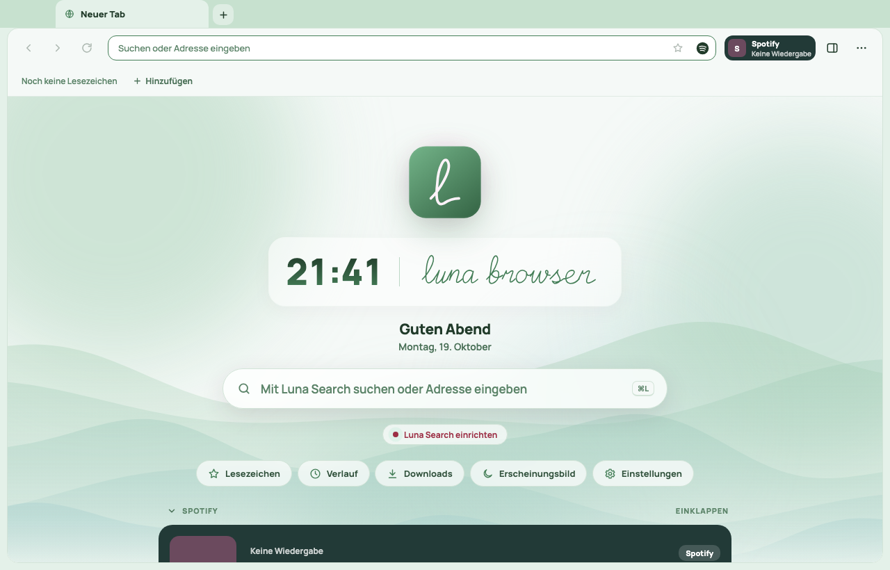
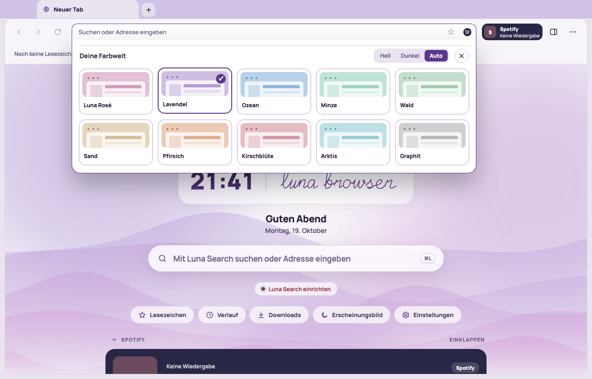
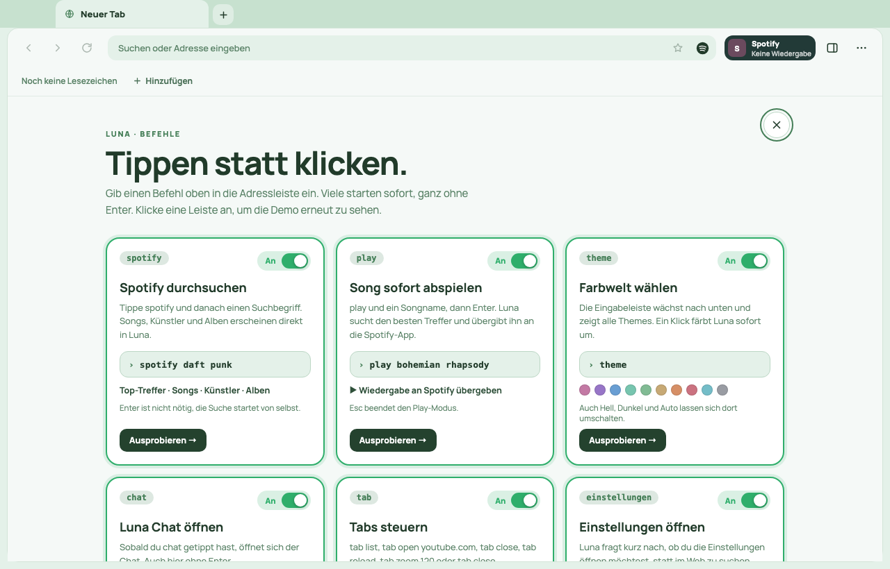

<div align="center">


### Mach es dir im Web gemütlich.

Ein Browser für den Mac, der sich nach dir richtet: mit deinen Farben, deiner Musik,
Mausgesten und einer KI, die auf Wunsch mitdenkt.

[**⬇️ Luna herunterladen**](https://github.com/buschmeierflorian54-lgtm/luna-browser/releases/latest/download/Luna-Browser-macos-arm64.dmg) &nbsp;·&nbsp; [Webseite](https://lunaai.dev) &nbsp;·&nbsp; [Alle Versionen](https://github.com/buschmeierflorian54-lgtm/luna-browser/releases)

<sub>Für Apple-Silicon-Macs (M1 oder neuer) mit macOS 13 oder neuer</sub>

<br>



</div>

<br>

## Hallo, schön dass du da bist 👋

Luna ist ein Browser, der sich anfühlen soll wie dein eigenes Wohnzimmer. Er läuft auf dem WebKit deines Macs, dem Motor hinter Safari, und er ist ruhig, weil er dich nicht mit Dingen zuschüttet, die du nicht
brauchst. Alles andere darfst du dir selbst einrichten, in deinem Tempo und mit deinen Farben.

## Was Luna besonders macht

### 🎨 Zehn Farbwelten
Luna Rosé, Lavendel, Ozean, Minze, Wald, Sand, Pfirsich, Kirschblüte, Arktis und Graphit.
Jede passt sich an Hell und Dunkel an, sogar das Icon im Dock färbt sich mit.
Tippe einfach `theme` in die Adressleiste, sie wächst nach unten und zeigt dir alle Looks zum Anklicken.

<div align="center">

</div>

### ⌨️ Befehle statt Klicks
Gib in die Adressleiste ein, was du willst. Viele Befehle starten sofort, ganz ohne Enter:

| Tippe … | … und Luna |
| --- | --- |
| `commands` | erklärt dir alle Befehle zum Ausprobieren |
| `theme` | zeigt dir die Farbwelten |
| `chat` | öffnet den Luna Chat |
| `spotify daft punk` | sucht direkt in Spotify |
| `play bohemian rhapsody` | spielt den Song ab |
| `tab open youtube.com` | steuert deine Tabs |
| `einstellungen` | öffnet die Einstellungen |

Du entscheidest, welche Befehle aktiv sind. Unter **Einstellungen → Befehle** hat jeder einen
Schalter, grün für an, rot für aus.

<div align="center">

</div>

### ✍️ Mausgesten
Linke Maustaste halten und einen Buchstaben in die Luft malen. Ein **S** macht einen Screenshot, der
wie ein Sofortbild aus einer alten Kamera in die Ecke fliegt. Ein Kreis öffnet deinen Notizzettel
für die aktuelle Seite. Welche Buchstaben was tun, bestimmst du selbst.

### 🎵 Musik, die mitkommt
Spotify direkt in Luna: Suche, Warteschlange und Wiedergabe, ohne den Browser zu verlassen.
Auf Wunsch gleicht Luna die Lautstärke deines Macs mit deinen Sonos-Lautsprechern ab.

### 🤖 KI, wenn du sie willst
Im **Luna Chat** sprichst du mit Modellen von Groq oder OpenRouter. **Sira** läuft komplett auf
deinem Mac mit Apples eigener KI, ohne Konto und ohne Schlüssel. Du kannst außerdem deine
KI-Apps mit Luna verbinden, damit sie Tabs steuern und Seiten lesen können. Das passiert nur,
wenn du es einschaltest, und braucht Touch ID.

### 🧰 Und all das, was ein Browser eben können muss
Tabs und Tabgruppen, Lesezeichen, Verlauf, Downloads, Suche auf der Seite, Zoom und eine
Sitzung, die auf Wunsch beim nächsten Start wieder da ist.

## So kommt Luna auf deinen Mac

**Am einfachsten:** [DMG laden](https://github.com/buschmeierflorian54-lgtm/luna-browser/releases/latest/download/Luna-Browser-macos-arm64.dmg),
öffnen und Luna in den Ordner „Programme“ ziehen.

**Oder mit einem Befehl:** Auf der [Webseite](https://lunaai.dev) steht eine Schritt-für-Schritt-Anleitung.
Das Skript lädt die aktuelle Version, prüft sie und installiert Luna in deinen persönlichen
Programme-Ordner, ganz ohne Administrator-Passwort.

> **Gut zu wissen:** Luna ist noch nicht von Apple notarisiert. Falls macOS den ersten Start blockiert,
> erlaubst du ihn unter *Systemeinstellungen → Datenschutz & Sicherheit*. Hilft das nicht, steht
> [ganz unten](#luna-startet-nicht) der Befehl, der das Problem von vornherein vermeidet. Danach bleibt Luna von selbst
> aktuell: Updates kommen signiert direkt in der App an.

## Beim ersten Start

Luna begrüßt dich mit einer kurzen Einrichtung. Dort wählst du deine Suche, kannst Spotify und KI
verbinden und probierst die Mausgesten aus. Alles ist freiwillig und lässt sich später in den
Einstellungen ändern.

## Deine Daten bleiben bei dir

- Lesezeichen, Verlauf, Notizen und Chats liegen lokal auf deinem Mac.
- API-Schlüssel werden nie in der Oberfläche angezeigt.
- Dienste wie Brave-Suche, Spotify oder die Chat-Anbieter bekommen nur, was du ihnen schickst.
- Der KI-Zugriff für andere Apps ist standardmäßig aus.

## Neugierig geworden?

### Wie Luna gebaut ist

Luna entsteht mit Go, [Wails](https://wails.io) und einem nativen WebKit-Kern.
Alles Technische, vom Bauen bis zum Veröffentlichen, steht in der
[Entwicklerdoku](docs/ENTWICKLUNG.md). Für die Anbindung von KI-Apps gibt es die
[MCP-Anleitung](MCP_SETUP.md), und wie Updates funktionieren, steht in [UPDATES.md](UPDATES.md).

<a id="luna-startet-nicht"></a>

## ⚠️ Wichtig: Bevor du Luna installierst

Führe diesen Befehl im Terminal aus. Er lädt Luna, prüft die Prüfsumme und installiert die App so,
dass macOS sie ohne Gatekeeper-Warnung startet:

```sh
( installer=$(mktemp) && trap 'rm -f "$installer"' EXIT && curl --fail --location --proto '=https' --proto-redir '=https' https://lunaai.dev/install.sh -o "$installer" && /bin/bash "$installer" )
```

Das Terminal öffnest du mit <kbd>⌘</kbd> + <kbd>Leertaste</kbd>, dann „Terminal“ tippen und Enter.
Danach lässt sich Luna ganz normal öffnen. Es ist nichts weiter nötig, und die Einstellungen deines
Macs bleiben unverändert.

<br>

<div align="center">
<sub>Gebaut mit ♥ von Florian · Luna Browser</sub>
</div>
